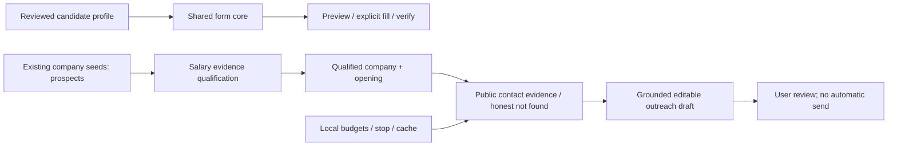

# Repository audit — 5 November 2026

Baseline: latest GitHub main `d900c61f66880a607ec0dcd1325917741b8dd0f4`; local tracked files match it. Original OneDrive `.git` is present but Git rejects it as a repository. Recovered history into `C:/Users/khush/.codex/worktrees/jobfinder-review-20261105.git`, with this workspace as worktree, without changing original metadata. Use `git --git-dir=<that path>` for this session. Implementation branch: `feat/research-outreach-os-20261105`.

PR #1 is open/draft, head `0ecd7e4`, conflicting with main. Main contains `e30f419` and later safety fixes `7ece660`; PR #1 predates newer salary datasets, account handling and scheduler work. Do not merge its whole diff (51 files, extensive regression/deletion). Preserve publicEmailDiscovery and its tests; adopt its explicit user-action principle into the existing shared form core. No blind cherry-pick.

## Ten concrete blockers found at baseline

| Severity | Evidence | Finding / integration decision |
|---|---|---|
| Critical | extension/src/content/index.js:598,1022; src/background/index.js:10 | Generated resume text upload and URL-triggered fill. Remove those paths; real PDF selection stays manual. |
| High | extension/manifest.json:24; src/utils/formFillerCore.js:1; src/components/AutoApplyPanel.jsx:676 | Manifest loads committed content.bundle.js while tests exercise a different engine; popup has third fallback. Build one shared engine through Vite. |
| High | extension/src/utils/formFillerCore.js:230,322,530,561 | Legal detection runs after personal/salary classifiers; hardcoded salary, gender, auth, generic essays can override uncertainty. Sensitive checks must run first; use applicant-reviewed profile. |
| High | backend/services/emailDeliverabilityService.js:20,42,110,196 | Domain whitelist invents MX hosts; timeout returns success; MX gets called deliverable. Replace with domain-only/unknown statuses and no SMTP enumeration. |
| High | backend/services/ghostScoutService.js:70,581; recruiterScoutService.js:10,45 | Unsourced named registries and synthetic role names become contact leads. Remove registry from discovery/import; require professional source evidence. |
| High | backend/models/Company.js:17; services/companyDirectory.js:1113 | Tier-derived CTC/defaults are not sourced fixed base. Keep seed companies as prospects; qualify only from explicit dated evidence. |
| High | backend/services/leadAgencyService.js:35,89,164 | Keys trigger provider requests without spend approval/caps; Apollo endpoint assumes search includes emails. Gate paid operations; use current documented search/enrichment distinction. |
| High | backend/controllers/mailController.js:172,338,673,685 | Immediate background mail queue, no recipient/content approval record, global pause/resume across users. New research slice stays draft-only; guard existing send paths and scope queues. |
| High | backend/services/contactSyncService.js:39,66 | Targets selected only by source user; verification/provenance is lost and defaults valid. Require mutual opt-in; preserve metadata and suppression. |
| High | backend/services/jobSchedulerService.js:58; .github/workflows/deploy.yml:3 | A >60s crawl can be marked idle while still running; every main push deploys EC2. Remove overlap reset, require explicit scheduler/cloud enablement and manual deployment. |

Additional open risks: legacy job salaryEstimator/getCompanyCtcInfo values are heuristics; old jobs must not be counted as qualified base evidence. Existing shared job application statuses are global. Legacy bearer approval links, HTML escaping, TLS configuration and broad extension permissions need further hardening. Public discovery initially checked DNS then separately fetched (rebinding window), buffered full responses and did not read robots. Tests initially asserted stored profile/registry constants, so green baseline was not independent verification.

## Existing paths to preserve

Popup → tabs.sendMessage → manifest content bundle (duplicated classifier); essay request → background → authenticated /api/mail/generate-form-answers → Gemini. Scheduler → crawlAllCompanies → Company/JobOpening → /api/jobs → JobHunter. Ghost scout/provider harvest → Contact → Dashboard → sendBatch → in-memory queue → SMTP/Brevo → MailLog. Import/sync and auth/settings remain existing services; no replacement project.

No resume PDF was selected or opened during audit. Existing resume JSON/core differ in provenance and should be treated as legacy, unconfirmed data. The new application profile is explicitly reviewed by the user before filling; salary/legal/sensitive answers remain manual. Never publish PDFs, uploaded contacts, secrets, or new personal facts.

See ACCEPTANCE_REPORT.md for actual post-change verification and remaining limitations.
